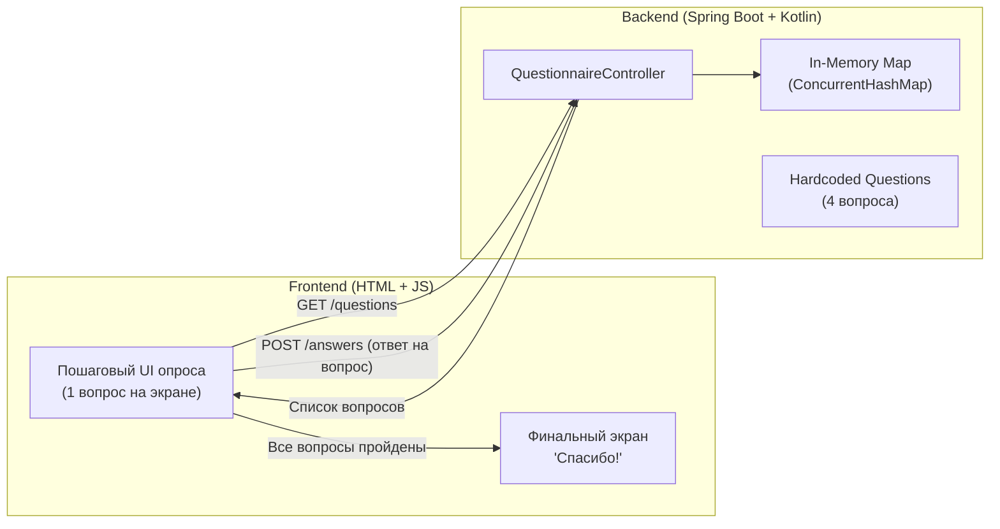

# План реализации: Full-Stack приложение с анкетой (Spring Boot Kotlin + HTML/JS)

Создание легковесного full-stack приложения:
- **Backend:** Spring Boot (Kotlin), Java 17, Gradle.
- **Frontend:** Vanilla HTML5 + CSS3 + JavaScript (SPA без внешних тяжелых фреймворков).
- **Директория проекта:** `C:\Users\rusgo\.gemini\antigravity\scratch\questionnaire-app` (будет рекомендована пользователю в качестве активного воркспейса).

---

## Архитектура и функционал



### 1. API контракты

#### `GET /questions`
Возвращает список из 4 предустановленных вопросов.
```json
[
  { "id": 1, "text": "Как вас зовут?" },
  { "id": 2, "text": "Какой ваш любимый язык программирования?" },
  { "id": 3, "text": "Какой бэкенд-фреймворк вы предпочитаете?" },
  { "id": 4, "text": "Сколько лет вы в разработке?" }
]
```

#### `POST /answers`
Принимает ответ пользователя и сохраняет его в памяти.
**Request Body:**
```json
{
  "questionId": 1,
  "answer": "Алексей",
  "sessionId": "optional-uuid"
}
```
*Примечание:* Поле `sessionId` генерируется на фронтенде в JS (UUID/timestamp), чтобы ответы разных пользователей в `Map` можно было группировать, либо ответы сохраняются в виде `ConcurrentHashMap<String, MutableMap<Int, String>>` (где ключ — идентификатор сессии пользователя, а значение — карта `questionId -> answer`).

**Response Body:**
```json
{
  "status": "success",
  "message": "Answer recorded"
}
```

---

## Предлагаемые изменения и компоненты

### 1. Инициализация проекта
- Скачивание шаблона через Spring Initializr API (`start.spring.io`):
  - Language: `kotlin`
  - Boot version: `3.3.x` / `3.4.x` (совместима с Java 17)
  - Type: `gradle-project` (с Gradle Wrapper `gradlew.bat`)
  - Dependencies: `web`, `jackson`
- Распаковка в `C:\Users\rusgo\.gemini\antigravity\scratch\questionnaire-app`.

---

### 2. Backend (Kotlin)

#### [NEW] `src/main/kotlin/com/example/questionnaire/model/Models.kt`
- DTO `Question(val id: Int, val text: String)`
- DTO `AnswerRequest(val questionId: Int, val answer: String, val sessionId: String?)`
- DTO `ApiResponse(val status: String, val message: String)`

#### [NEW] `src/main/kotlin/com/example/questionnaire/service/QuestionnaireService.kt`
- Потокобезопасное хранилище `ConcurrentHashMap<String, MutableMap<Int, String>>`.
- Метод `getQuestions(): List<Question>`.
- Метод `saveAnswer(request: AnswerRequest)`.
- Вспомогательный метод `getAllAnswers(): Map<String, Map<Int, String>>` (для проверки и отладки).

#### [NEW] `src/main/kotlin/com/example/questionnaire/controller/QuestionnaireController.kt`
- `@RestController` с аннотацией `@CrossOrigin(origins = ["*"])`.
- `@GetMapping("/questions")`: вызов сервиса и возврат списка вопросов.
- `@PostMapping("/answers")`: приём DTO ответа и сохранение в памяти.
- `@GetMapping("/answers")`: (опционально для удобства проверки) просмотр сохранённых ответов в памяти.

---

### 3. Frontend (HTML + CSS + JS)

Будет расположен в `src/main/resources/static/index.html` (обслуживается Spring Boot по адресу `http://localhost:8080/`), а также доступен для независимого открытия в браузере.

#### [NEW] `src/main/resources/static/index.html`
- Чистый, современный адаптивный интерфейс с приятным дизайном (карточка вопроса, поле ввода, кнопка «Далее»).
- Индикатор прогресса (например: «Вопрос 1 из 4» и прогресс-бар).
- Сценарий на JavaScript:
  1. При загрузке страницы генерирует уникальный `sessionId` в `sessionStorage`.
  2. Запрашивает `fetch('/questions')` (с fallback на относительный URL).
  3. Рендерит поочерёдно текущий вопрос.
  4. При нажатии на кнопку отправки отправляет `POST /answers` с `questionId`, `answer` и `sessionId`.
  5. Переключает на следующий вопрос с плавной анимацией.
  6. Когда вопросы заканчиваются — скрывает форму и отображает финальный экран:
     **«Спасибо!»** с сообщением об успешном прохождении.

---

## План верификации

### Автоматические тесты
1. Запуск интеграционного теста Spring Boot Test:
   - Проверка `GET /questions` (возвращает статус 200 и непустой список).
   - Проверка `POST /answers` (возвращает статус 200 при отправке ответа).
   - Команда: `.\gradlew.bat test` в директории проекта.

### Ручная проверка
1. Запуск приложения: `.\gradlew.bat bootRun`.
2. Проверка эндпоинтов через curl/PowerShell:
   - `Invoke-RestMethod -Uri http://localhost:8080/questions`
   - `Invoke-RestMethod -Uri http://localhost:8080/answers -Method POST -Body '{"questionId":1,"answer":"Тест"}' -ContentType 'application/json'`
3. Открытие в браузере `http://localhost:8080/`:
   - Прохождение всех вопросов по очереди.
   - Проверка перехода к следующему вопросу только после ответа.
   - Проверка появления экрана «Спасибо!» в конце.
